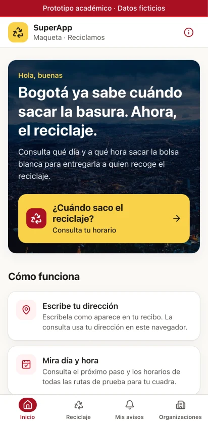
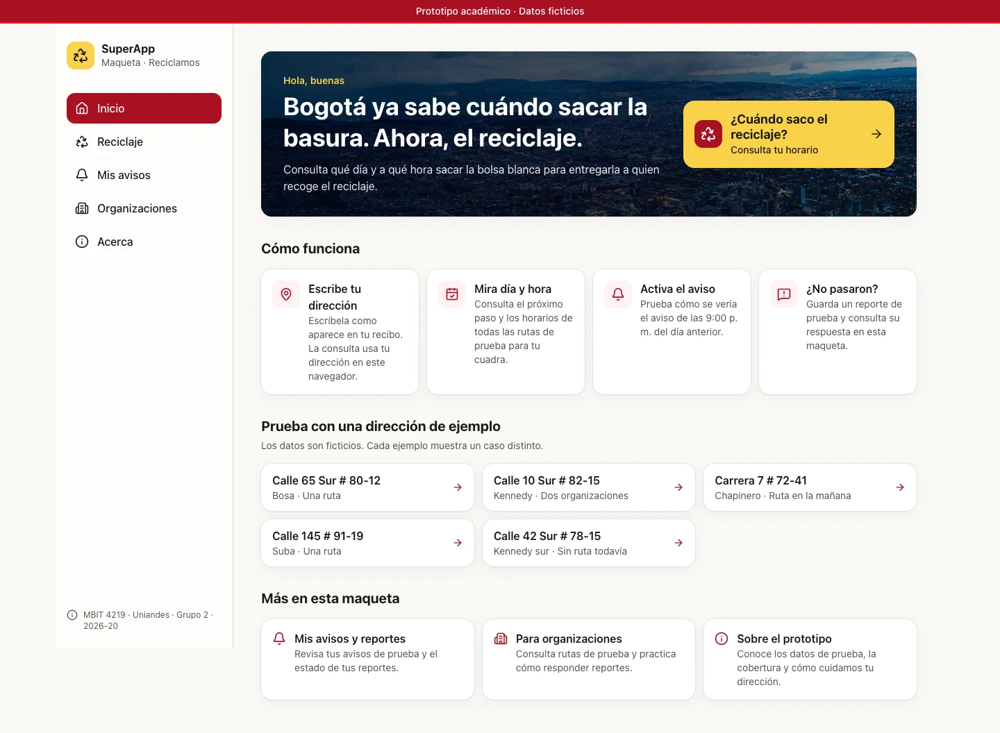

# Reciclamos · ¿Cuándo saco el reciclaje?

Prototipo funcional para la **Bogotá SuperApp**. Con una dirección de Bogotá, muestra **qué día y a qué hora** se sacaría la bolsa blanca para entregarla a quien recoge el reciclaje. Permite ensayar un aviso, registrar un reporte y responderlo en la vista de organizaciones.

Proyecto académico del curso **MBIT 4219 · Transformación Digital del Estado y la Sociedad** (Universidad de los Andes, 2026-20, Grupo 2). Es el entregable de *prototipado* de la segunda entrega de la estrategia de transformación digital.

> **Prototipo académico con datos ficticios.** No es un servicio oficial de la Alcaldía de Bogotá ni de la UAESP. Las organizaciones, rutas y horarios son inventados.

| Teléfono | Escritorio |
|---|---|
|  |  |
|  |  |

## Qué hace

| Pantalla | Qué resuelve |
|---|---|
| **Inicio** | Presenta Reciclamos, ofrece ejemplos y muestra un resumen si hay un aviso de prueba activo. |
| **Reciclaje** | La consulta abre en `/reciclaje`. Acepta los formatos habituales de Bogotá y muestra día, franja y todas las organizaciones del catálogo que pasan por la cuadra. Ofrece ejemplos y separa el horario del camión. «Usar mi ubicación» muestra un horario de referencia de la zona. |
| **Aviso de prueba** | Simula el aviso de las 9:00 p. m. del día anterior. Guarda la cuadra con consentimiento y ofrece una vista previa en pantalla. |
| **¿No pasaron?** | Guarda un reporte de prueba con número de seguimiento. La respuesta se ensaya en la herramienta de organizaciones del mismo navegador. |
| **Mis avisos y reportes** | Aviso activo, solicitudes de aviso, reportes, respuestas y borrado de datos. |
| **Organizaciones** | Reportes pendientes primero, con acceso a las rutas y al historial de respuestas de prueba. |
| **Acerca** | Qué es real y qué es simulado, privacidad y cobertura del prototipo. |

### Direcciones para probar

| Dirección | Caso |
|---|---|
| `Calle 65 Sur # 80-12` | Bosa, una organización |
| `Calle 10 Sur # 82-15` | Kennedy, dos organizaciones en la misma cuadra |
| `Carrera 7 # 72-41` | Chapinero, ruta en la mañana |
| `Calle 145 # 91-19` | Suba |
| `Calle 70 # 100-20` | Engativá, tres días por semana |
| `Calle 42 Sur # 78-15` | Kennedy, sector sin ruta registrada |
| `Calle 120 # 7-30 Apto 301` | Usaquén; el apartamento y lo que siga a la placa se ignoran |
| `Calle 30 # 2-10` | Muestra un horario de ejemplo de una zona cercana, sin asociar avisos ni reportes |
| `mi casa`, `Calle 500 # 1-1` | Errores de formato y de rango |

## Cómo correrlo

Requiere **Node.js 22.12 o superior** (el archivo `.node-version` fija Node 24 LTS para `fnm`, `nvm` o `volta`).

```bash
npm install
npm run dev            # http://localhost:3000
```

| Comando | Qué hace |
|---|---|
| `npm run dev` | Servidor de desarrollo |
| `npm run build` y `npm start` | Compilación y servidor de producción |
| `npm run lint` | ESLint (reglas de Next.js y TypeScript) |
| `npm run typecheck` | Verificación de tipos con TypeScript estricto |
| `npm test` | Pruebas unitarias del dominio (Vitest) |
| `npm run test:e2e` | Pruebas de punta a punta en teléfono y escritorio, con accesibilidad (Playwright + axe). Usan el Chrome instalado |
| `npm run check` | Lint, tipos, pruebas unitarias y compilación |

## Despliegue en Vercel

No necesita configuración ni variables de entorno: todas las páginas son estáticas.

1. En Vercel, **Add New → Project** e importa este repositorio.
2. Deja los valores por defecto (Framework: Next.js) y despliega.

Vercel toma la versión de Node del campo `engines` de `package.json`.

## Cómo está organizado

```
src/
├── app/                      Rutas (App Router): páginas delgadas que componen funcionalidades
│   ├── page.tsx              Inicio con acceso a la consulta y ejemplos
│   ├── reciclaje/            Consulta por dirección
│   ├── mis-avisos/           Aviso, cuadras en espera y reportes del ciudadano
│   ├── organizaciones/       Herramienta para organizaciones
│   └── acerca/               Sobre el prototipo
├── features/                 Lógica por funcionalidad
│   ├── direcciones/          Lectura de la nomenclatura vial de Bogotá (función pura + pruebas)
│   ├── territorio/           Zonas aproximadas de la malla vial
│   ├── rutas/                Catálogo ficticio, horarios en hora de Bogotá, consulta y pantallas
│   ├── avisos/               Aviso de la noche anterior
│   └── reportes/             «¿No pasaron?» y herramienta de organizaciones
├── components/               Marco de la app, navegación y componentes de interfaz
└── lib/almacen.ts            Persistencia local compatible con renderizado en servidor
e2e/                          Pruebas de punta a punta
docs/                         Arquitectura, atributos de calidad y decisiones
```

Más detalle en [docs/arquitectura.md](docs/arquitectura.md), [docs/atributos-de-calidad.md](docs/atributos-de-calidad.md) y [docs/decisiones.md](docs/decisiones.md).

## Equipo

David Alejandro Abril Medina, Paula Andrea Cañon Camelo, David Elias Forero Cobos y Maria Paulina Ocampo Peralta. Profesor: Javier Orlando Torres Páez.
