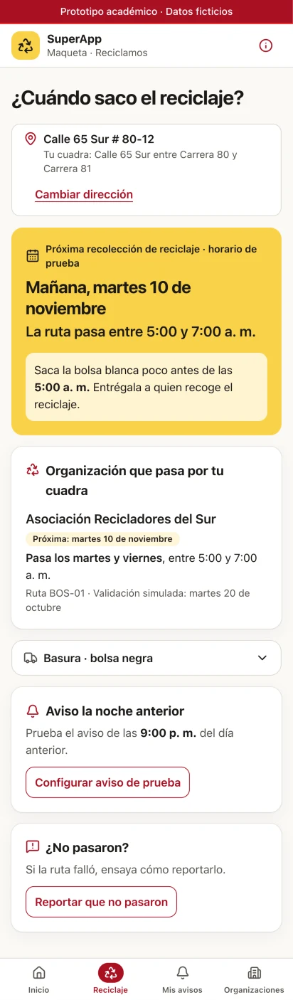
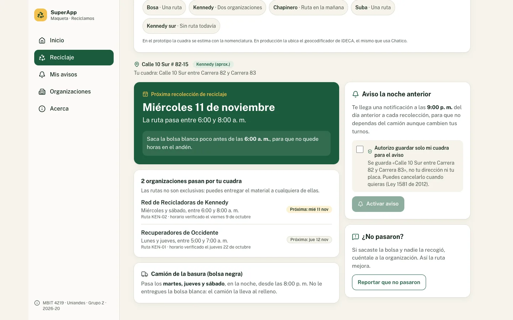

# Reciclamos · ¿Cuándo saco el reciclaje?

Prototipo funcional de una función para la **Bogotá SuperApp**: con la dirección, le dice a cada hogar **qué día y a qué hora** sacar la bolsa blanca para que llegue a un reciclador de oficio y no al camión de la basura. Si la ruta no pasa, el hogar lo reporta y la organización responde.

Proyecto académico del curso **MBIT 4219 · Transformación Digital del Estado y la Sociedad** (Universidad de los Andes, 2026-20, Grupo 2). Es el entregable de *prototipado* de la segunda entrega de la estrategia de transformación digital.

> **Prototipo académico con datos ficticios.** No es un servicio oficial de la Alcaldía de Bogotá ni de la UAESP. Las organizaciones, rutas y horarios son inventados.

| Teléfono | Escritorio |
|---|---|
|  |  |

## Qué hace

| Pantalla | Qué resuelve |
|---|---|
| **Inicio** | La función vive como una tarjeta más de la SuperApp. Muestra el aviso activo, si existe. |
| **Reciclaje** | Lee direcciones de Bogotá en cualquier formato habitual (`Cl 65 S 80 12`, `Carrera 80 # 65-12 Sur`, `Av Calle 26 # 85-10`, `Calle 65A Bis Sur # 80B-12`…), ubica la cuadra y muestra la próxima recolección, **todas** las organizaciones habilitadas que pasan por ella (las rutas no son exclusivas) y el horario del camión. Si no hay ruta, lo dice con honestidad y ofrece «Avísame cuando haya ruta». |
| **Aviso** | Notificación a las 9:00 p. m. del día anterior, con consentimiento explícito. Guarda **la cuadra, nunca la dirección**. Incluye una vista previa de la notificación. |
| **¿No pasaron?** | Reporte de incidencia (no pasó, pasó el camión antes, otro) con número de seguimiento. Llega a la organización, separado de las PQR formales. |
| **Mis avisos** | Aviso activo, cuadras en espera de ruta, estado de los reportes con la respuesta de la organización y «Borrar mis datos». |
| **Organizaciones** | Herramienta web de las organizaciones: rutas publicadas con su ficha de calidad y reportes por responder, con el indicador del objetivo OE4 (90 % respondidos en 72 h). |
| **Acerca** | Qué es real y qué es simulado, privacidad y cobertura del prototipo. |

### Direcciones para probar

| Dirección | Caso |
|---|---|
| `Calle 65 Sur # 80-12` | Bosa, una organización |
| `Calle 10 Sur # 82-15` | Kennedy, dos organizaciones en la misma cuadra |
| `Carrera 7 # 72-41` | Chapinero, ruta en la mañana |
| `Calle 145 # 91-19` | Suba |
| `Calle 70 # 100-20` | Engativá, tres días por semana |
| `Calle 42 Sur # 78-15` | Kennedy, sector sin ruta registrada |
| `Calle 120 # 7-30` | Usaquén, localidad fuera del piloto |
| `Calle 30 # 2-10` | Zona que el prototipo no conoce |
| `mi casa`, `Calle 500 # 1-1` | Errores de formato y de rango |

## Cómo correrlo

Requiere **Node.js 22.12 o superior** (el archivo `.node-version` fija Node 24 LTS para `fnm`, `nvm` o `volta`).

```bash
npm install
npm run dev            # http://localhost:3000
```

| Comando | Qué hace |
|---|---|
| `npm run dev` | Servidor de desarrollo |
| `npm run build` y `npm start` | Compilación y servidor de producción |
| `npm run lint` | ESLint (reglas de Next.js y TypeScript) |
| `npm run typecheck` | Verificación de tipos con TypeScript estricto |
| `npm test` | Pruebas unitarias del dominio (Vitest) |
| `npm run test:e2e` | Pruebas de punta a punta en teléfono y escritorio, con accesibilidad (Playwright + axe). Usan el Chrome instalado |
| `npm run check` | Lint, tipos, pruebas unitarias y compilación |

## Despliegue en Vercel

No necesita configuración ni variables de entorno: todas las páginas son estáticas.

1. En Vercel, **Add New → Project** e importa este repositorio.
2. Deja los valores por defecto (Framework: Next.js) y despliega.

Vercel toma la versión de Node del campo `engines` de `package.json`.

## Cómo está organizado

```
src/
├── app/                      Rutas (App Router): páginas delgadas que componen funcionalidades
│   ├── page.tsx              Inicio
│   ├── reciclaje/            Consulta por dirección
│   ├── mis-avisos/           Aviso, cuadras en espera y reportes del ciudadano
│   ├── organizaciones/       Herramienta para organizaciones
│   └── acerca/               Sobre el prototipo
├── features/                 Lógica por funcionalidad
│   ├── direcciones/          Lectura de la nomenclatura vial de Bogotá (función pura + pruebas)
│   ├── territorio/           Zonas aproximadas y geolocalización
│   ├── rutas/                Catálogo ficticio, horarios en hora de Bogotá, consulta y pantallas
│   ├── avisos/               Aviso de la noche anterior
│   └── reportes/             «¿No pasaron?» y herramienta de organizaciones
├── components/               Marco de la app, navegación y componentes de interfaz
└── lib/almacen.ts            Persistencia local compatible con renderizado en servidor
e2e/                          Pruebas de punta a punta
docs/                         Arquitectura, atributos de calidad y decisiones
```

Más detalle en [docs/arquitectura.md](docs/arquitectura.md), [docs/atributos-de-calidad.md](docs/atributos-de-calidad.md) y [docs/decisiones.md](docs/decisiones.md).

## Equipo

David Alejandro Abril Medina, Paula Andrea Cañon Camelo, David Elias Forero Cobos y Maria Paulina Ocampo Peralta. Profesor: Javier Orlando Torres Páez.
