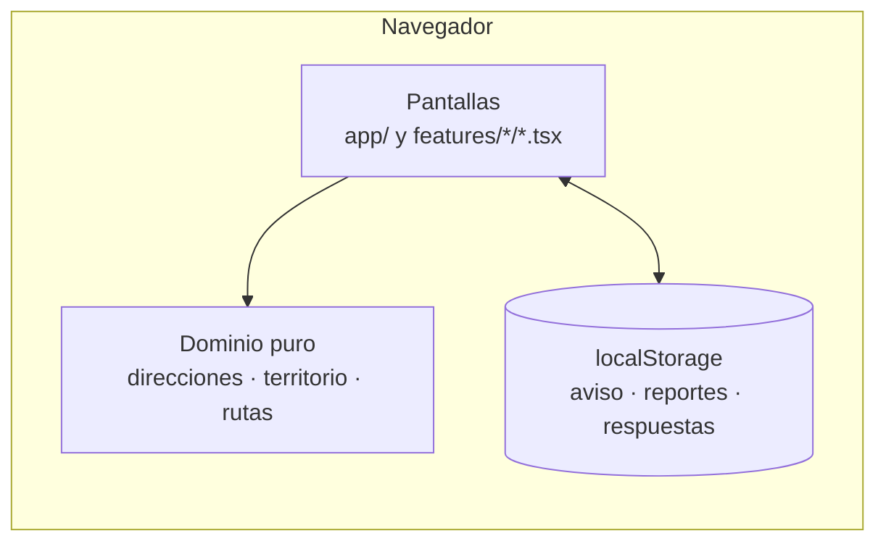

# Arquitectura

## Vista general

El prototipo es una aplicación **Next.js 16 (App Router)** sin backend. Todas las rutas se generan como páginas estáticas en la compilación; la interacción ocurre en componentes de cliente.

### Capas

| Capa | Dónde | Regla |
|---|---|---|
| Rutas | `src/app/` | Páginas delgadas: título, metadatos y composición. Sin lógica de negocio. |
| Interfaz por funcionalidad | `src/features/*/*.tsx` | Componentes de cliente que llaman al dominio y al almacén. |
| Dominio | `src/features/{direcciones,territorio,rutas}/*.ts` | Funciones puras y deterministas, sin React ni navegador. Reciben la hora como parámetro. |
| Persistencia | `src/lib/almacen.ts` | `localStorage` detrás de `useSyncExternalStore`, con valor inicial en el servidor para no romper la hidratación. |

## Flujo de una consulta

1. `leerDireccion` normaliza el texto (tildes, mayúsculas, «No.», «№», abreviaturas) y lo interpreta con la nomenclatura de Bogotá: tipo de vía, números, letras, «Bis», cuadrante Sur o Este y placa.
2. La dirección se convierte en un punto de la malla vial: calles hacia el norte (Sur negativo) y carreras hacia el occidente (Este negativo).
3. `zonaDe` ubica el punto en una zona aproximada. `rutasEn` filtra las rutas cuya cobertura lo contiene.
4. `proximaRecoleccion` calcula, en hora de Bogotá (UTC−5, sin horario de verano), el próximo día de paso de cada ruta. Si la ruta pasa hoy y la ventana ya terminó, salta al siguiente.
5. El resultado es una unión discriminada: `error-direccion`, `fuera-de-cobertura`, `sin-ruta` o `con-ruta`. Cada estado tiene su pantalla.

## Cómo se articula con la SuperApp en producción

| Prototipo | Producción |
|---|---|
| Zonas rectangulares sobre la malla | Geocodificador de **IDECA** (el mismo que usa Chatico) |
| `datos.ts` con rutas ficticias | Capa de rutas del convenio: microrrutas del **SUI** (Superservicios), rutas del piloto y **RUOR** (UAESP), mantenidas por las organizaciones |
| Vista previa del aviso en pantalla | Notificaciones push y consentimiento de la SuperApp |
| `localStorage` | Sesión y perfil de la SuperApp; servicio de reportes con respaldo por WhatsApp |
| Herramienta de organizaciones local | Herramienta web con validación de la UAESP antes de publicar cambios |

El dominio no depende de ninguna de esas fuentes: cambiar `datos.ts` por un cliente del servicio de rutas no toca las pantallas.
